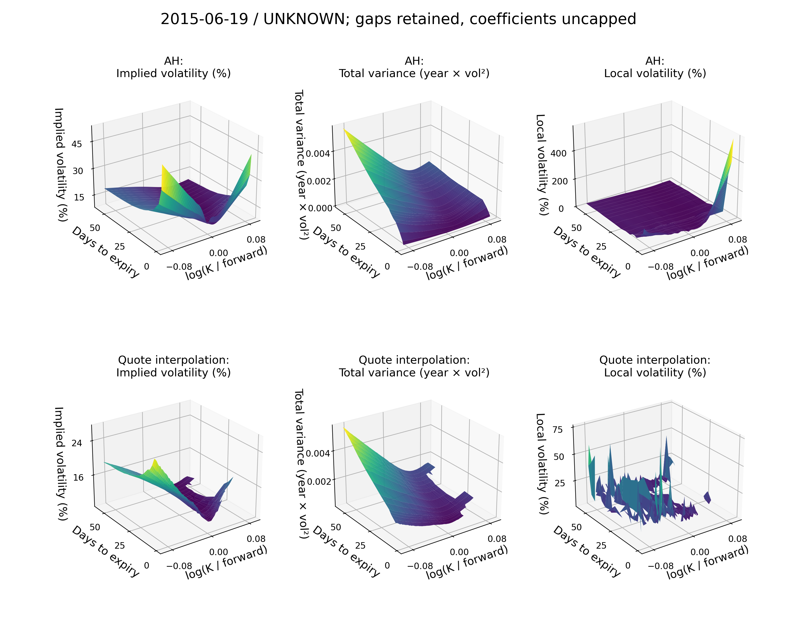

# SPX local volatility and delta hedging

This project constructs daily volatility surfaces from SPX end-of-day option
quotes and tests whether their deltas improve historical hedge errors. The
implementation combines Andreasen–Huge calibration, Dupire local variance,
backward-PDE pricing, smile-based hedge conventions and a correction estimated
from past option-price changes.

The completed 2013–2023 study selected **44,500 option entries** across **2,768
reference dates**. For five-session holdings with daily rebalancing and midpoint
marks, the AH hedge produced **30.16% more squared funded error than Black** on
the common-entry sample. The experiment distinguishes calibration accuracy,
numerical stability and subsequent hedging performance; each is assessed with
its own evidence.

The [standalone report](docs/report.pdf) ([editable source](docs/report.md))
contains the derivations, experiment specification and full results.

## Contents

- [Local and implied volatility](#local-and-implied-volatility)
- [Dupire's equation](#dupires-equation)
- [Surface construction](#surface-construction)
- [Backward pricing and Greeks](#backward-pricing-and-greeks)
- [Hedge rules](#hedge-rules)
- [Historical experiment](#historical-experiment)
- [Results and interpretation](#results-and-interpretation)
- [Numerical checks](#numerical-checks)
- [Implementation and reproduction](#implementation-and-reproduction)
- [References](#references)

## Local and implied volatility

Fix one valuation date as time zero. Let $S_t$ be the index level, $K$ the
strike, $t$ elapsed time and $T$ expiry, all times in ACT/365F years. Call prices
$C$ and strikes use index points. $r(t)$ is the deterministic pricing rate and
$q(t)$ the yield implied by pricing carry; $D(t)=\exp[-\int_0^t r(u)du]$ and
$F(t)=S_0\exp[\int_0^t(r(u)-q(u))du]$. $W^{\mathbb Q}$ denotes risk-neutral
Brownian motion; $\Phi$ and $\phi$ are the standard normal distribution and
density. Volatilities are annualized decimals. Pricing yield is distinct from
the zero dividend cash assumed in the hedge account.

With deterministic pricing rates and dividend yield, a local-volatility model
represents the index under a risk-neutral measure as

$$
\frac{dS_t}{S_t}=[r(t)-q(t)]\,dt+
\sigma_{\mathrm{LV}}(S_t,t)\,dW_t^{\mathbb Q}.
$$

The coefficient is a deterministic function of the current index level and
time. The index itself remains stochastic. A constant coefficient gives the
Black–Scholes special case; dependence on level and time allows a model to
represent a volatility smile and term structure.

Implied volatility is a different quantity. For a European call with strike
$K$, time to expiry $T$, forward $F(T)$ and discount factor $D(T)$, it solves

$$
C_{\mathrm{market}}(K,T)
=D(T)\big[F(T)\Phi(d_1)-K\Phi(d_2)\big],
\qquad
 d_1=\frac{\log(F(T)/K)+\tfrac12\sigma_{\mathrm{imp}}^2T}
 {\sigma_{\mathrm{imp}}\sqrt{T}},
\quad d_2=d_1-\sigma_{\mathrm{imp}}\sqrt{T}.
$$

It is the constant Black volatility that reproduces one option price. A daily
implied-volatility surface collects those values across strikes and maturities.
Local volatility instead specifies the instantaneous diffusion used to price
and hedge within a model. Recovering it requires information about how option
prices change across both strike and maturity.

Volatility is annualized and expressed in decimal units in the code. Time uses
years on an ACT/365F basis. Plots report volatility in percent and option prices
in index points. The plotting coordinates are

$$
y=\log\!\left(\frac{K}{F(T)}\right),
\qquad w(y,T)=\sigma_{\mathrm{imp}}(y,T)^2T.
$$

Here $w$ is total implied variance.

## Dupire's equation

For a sufficiently regular European call-price surface, deterministic carry
and positive strike curvature, the forward pricing equation gives

$$
\sigma_{\mathrm{LV}}^2(K,T)=
\frac{2\big[C_T+q(T)C+(r(T)-q(T))K C_K\big]}
{K^2 C_{KK}}.
$$

All derivatives refer to options observed on one valuation date. The maturity
derivative moves along that day's term structure; it is not a difference
between two historical quote dates. The coefficient at state $K$ and future
time $T$ is inferred from the current price surface around that strike and
maturity.

Strike curvature is central to the calculation. In the regular deterministic-
rate setting, $C_{KK}$ is the discounted terminal risk-neutral density. Small
curvature can therefore make the recovered coefficient sensitive to small
price errors. Convexity, maturity consistency, interpolation support and
numerical derivatives matter before a local-volatility plot can be interpreted.

### Coordinates used in the implementation

The calibration removes deterministic carry by defining

$$
z=\frac{K}{F(T)},\qquad
c(z,T)=\frac{C(F(T)z,T)}{D(T)F(T)}.
$$

In these coordinates,

$$
\partial_T c(z,T)=\frac12 a(z,T)z^2\partial_{zz}c(z,T),
\qquad
 a(z,T)=\frac{2c_T(z,T)}{z^2c_{zz}(z,T)}.
$$

The time derivative is taken at fixed normalized strike $z$. The function
$a(z,T)$ supplies local variance at the physical index level $F(T)z$. The
initial normalized call payoff is $c(z,0)=(1-z)^+$.

This normalization is also used by the backward pricer. It keeps the forward
and discount assumptions explicit and avoids confusing calibration parameters
with the recovered diffusion coefficient.

## Surface construction

### Quotes and carry

The dataset contains 132 monthly files and 14,750,241 raw rows. The audit checks
timestamps, contract fields, duplicates, index marks and bid-ask validity. Of
2,768 reference sessions, 24 have missing observations and 21 observed
early-close dates are excluded pending clock review.

The primary parity fit uses $|\log(K/S)|\leq0.03$ and requires at least six
selected call-put pairs per expiry. Near-the-money pairs estimate an expiry forward under an assumed
pricing discount factor. Put-call parity is

$$
C(K,T)-P(K,T)=D(T)[F(T)-K].
$$

An out-of-the-money quote is chosen at each calibration strike and converted
to an equivalent call when necessary. Original quote half-spreads are retained
as calibration weights. Quotes without an invertible positive midpoint IV
remain visible in price-space diagnostics.

### Andreasen–Huge calibration

Each expiry is calibrated sequentially on a finite normalized-strike grid.
Within a maturity interval, a fully implicit step has the form

$$
\big[I-\Delta T_i A(\nu_i)\big]c_i=c_{i-1},
\qquad A(\nu_i)=\tfrac12\nu_i(z)^2z^2\partial_{zz}.
$$

The positive proxy volatility $\nu_i$ is parameterized through log-volatility
controls. Its parameters minimize equivalent-call price residuals in original
half-spread units, with a penalty on adjacent log-control differences:

$$
\min_{p_i}\;
\sum_j\left[
\frac{C_{\mathrm{model}}(K_j,T_i;p_i)-C_{\mathrm{mid},j}}
{h_j}\right]^2
+\lambda\|L p_i\|^2,
\qquad h_j=\tfrac12(C_{\mathrm{ask},j}-C_{\mathrm{bid},j}).
$$

$L$ is the first-difference matrix for neighboring controls. Reported residuals
include both index-point errors and half-spread errors, with counts of prices
outside the original bid-ask bands.

**The fitted proxy volatility is not the recovered local volatility.** The
native price construction determines $c_T$ and $c_{zz}$; their ratio determines
$a$. The coefficient implementation uses positive density and derivative
calculations in logarithmic form to preserve small wing quantities. It does
not obtain curvature by differentiating a piecewise-linear price interpolant.

The frozen calibration uses 8,000 intervals, log-domain half-width 1.0 and up
to 31 control points per expiry. The first-difference penalty has $\lambda=1$;
proxy volatilities are bounded between 0.005 and 3.0, without capping recovered
coefficients. Numerical settings and input hashes are retained
with the study.

### Short-end diffusion blend

Write $a_y(y,t)=a(e^y,t)$. Before the first fitted maturity $T_1$, the historical hedge diffusion blends
native variance with a Gaussian average in log normalized state:

$$
\widetilde a_y(y,t)=
[1-\omega(t)]a_y(y,t)+\omega(t)(G_\rho*a_y)(y,t),
\qquad \omega(t)=\left(1-\frac{t}{T_1}\right)^2,
\quad 0\lt t\lt T_1.
$$

The implementation uses a finite discrete Gaussian filter and retains raw
variance from $T_1$ onward. The historical radius is $\rho=0.0005$.
This blend changes the pricing diffusion relative to the native fitted price
surface. Its effect on prices, deltas and gamma is measured separately; a
smoother coefficient is not automatically a more accurate one.

### Independent surface diagnostics

A quote-based comparison interpolates total variance with PCHIP in $y$ and
linearly across expiries. It uses contiguous valid quote support. For a smooth
$w(y,T)$, the total-variance form of Dupire is

$$
a_y(y,T)=\frac{w_T}{g(y,T)},\qquad
 g=\left(1-\frac{y w_y}{2w}\right)^2
 -\frac{w_y^2}{4}\left(\frac1w+\frac14\right)+\frac{w_{yy}}2.
$$

Unsupported regions, negative calendar derivatives, invalid density factors
and unstable derivative stencils remain unavailable. This interpolation is a
diagnostic comparison and was not used as a historical hedge diffusion.

A separate constrained SSVI comparison uses

$$
w(y,\theta)=\frac{\theta}{2}
\left[1+\rho_{\mathrm{SVI}}\varphi(\theta)y+
\sqrt{(\varphi(\theta)y+\rho_{\mathrm{SVI}})^2+1-\rho_{\mathrm{SVI}}^2}\right],
\qquad \varphi(\theta)=\frac{\eta}{\sqrt{\theta(1+\theta)}}.
$$

Nondecreasing ATM variance $\theta$, $|\rho_{\mathrm{SVI}}|\lt 1$, $\eta\geq0$ and
$\eta^2(1+|\rho_{\mathrm{SVI}}|)\lt 4$ supply the implemented sufficient
static-arbitrage conditions. The simple
shared-shape family fits the inspected market quotes less closely than AH.
It remains a surface diagnostic; it was not a hedge method in the frozen study.

## Backward pricing and Greeks

For a European payoff, the usual local-volatility backward equation is

$$
V_t+[r(t)-q(t)]S V_S+\tfrac12\sigma_{\mathrm{LV}}^2(S,t)S^2V_{SS}-r(t)V=0,
\qquad V(S,T)=(S-K)^+
$$

for a call, with the corresponding put payoff for a put. The implementation
works with $x=S/F(t)$ and $y=\log x$. For the normalized conditional payoff
$U(y,t)$, its generator gives

$$
U_t+\tfrac12\widetilde a_y(y,t)(U_{yy}-U_y)=0.
$$

The solver marches backward using midpoint Crank–Nicolson, implicit Rannacher
steps at the payoff, maturity breaks aligned with coefficient changes and a
time mesh graded toward zero. The frozen hedge grid has 24,000 intervals,
log-domain half-width 0.75 and 128 nominal steps per day. Coefficients are
sampled at positive times within supported domains.

For $k=K/F(T)$, the normalized terminal call payoff is $(x-k)^+$. Currency or
index-point prices are restored with $A(t,T)=D(T)F(T)/D(t)$:

$$
V(S,t)=A(t,T)U\!\left(\log\frac{S}{F(t)},t\right),\qquad
\Delta_{\mathrm{AH}}=\frac{A U_y}{S},\qquad
\Gamma_{\mathrm{AH}}=\frac{A(U_{yy}-U_y)}{S^2}.
$$

Spot derivatives hold the saved coefficient and deterministic carry fixed.
They do not recalibrate the surface. A new historical rebalance loads a newly
calibrated current-date model, which is a separate operation.

## Hedge rules

The observed-IV Black spot delta holds IV fixed and scales the forward with
spot at fixed $F/S$:

$$
\Delta_B=\frac{DF}{S}
\big[\Phi(d_1)-\mathbf 1_{\{\mathrm{put}\}}\big],
\qquad \mathcal V_B=DF\phi(d_1)\sqrt T.
$$

Vega $\mathcal V_B$ is per unit decimal annual volatility. Let
$\sigma_y=\partial\sigma_{\mathrm{surface}}/\partial\log(K/F)$.

| Method | Hedge convention |
| --- | --- |
| Black | Spot delta at observed midpoint IV |
| AH PDE | Spot derivative under the saved local-variance diffusion |
| Sticky strike | Black delta at fitted IV, with fitted IV fixed at strike |
| Sticky delta | $\Delta_B(\sigma_{\mathrm{surface}})-\mathcal V_B(\sigma_{\mathrm{surface}})\sigma_y/S$ |
| LV smile | $\Delta_B(\sigma_{\mathrm{obs}})+\mathcal V_B(\sigma_{\mathrm{obs}})\sigma_y/K$ |
| Empirical MV | Black delta plus a correction fitted from completed past outcomes |
| Unhedged | Zero index position |

Sticky delta uses an unadjusted normalized forward-call-delta smile, with
invertibility and derivative checks. The LV-smile rule is a smile approximation,
not the backward-PDE delta. These rules encode different assumptions about
smile movement, so their corrections are not interchangeable.

### Past-only empirical correction

The ideal one-period minimum-variance hedge motivates

$$
h^*=\frac{\mathrm{Cov}(\Delta C,\Delta S)}
{\mathrm{Var}(\Delta S)}.
$$

The implemented empirical rule uses the feature vector

$$
x_i=\frac{\mathcal V_{B,i}}{S_i\sqrt{T_i}}
\begin{bmatrix}1&\Delta_{B,i}&\Delta_{B,i}^2\end{bmatrix},
\qquad \Delta_{\mathrm{MV},i}=\Delta_{B,i}+x_i\widehat\beta.
$$

Ordinary least squares, without an intercept, fits
$\Delta C_i-\Delta_{B,i}\Delta S_i$ against $x_i\Delta S_i$. Fits are separate
by root and option kind, using up to 60 past entry dates. Every admitted outcome
must end strictly before the prediction timestamp. Warm-up, rank and
conditioning failures remain in coverage. The fitted objective uses raw price
changes; the funded multi-session hedge error is evaluated afterward.

## Historical experiment

Entries target 21, 35 and 45 calendar days to expiry and spot log-moneyness
$\log(K/S)$ of $-0.02$, $0$ and $+0.02$, for calls and puts. Selection is based
on current-date information and deduplicates targets that choose the same
contract. Each path then retains that contract through its holding period.

The holding/rebalance schedules are **1/1, 5/1, 5/5, 10/1 and 10/5 reference
sessions**. Missing marks do not extend a path to the next available date.
Rebalancing uses saved current-date decisions and observed option/index marks.

The option position is short one unit. The midpoint scenario uses midpoint
entry and exit prices. Spread scenarios sell at bid and close at ask; the fee
scenario additionally charges 1 bp of traded hedge notional. The hedge is a
fractional synthetic index position. Pricing and cash funding use an assumed
constant 5% rate, while dividend cash in the hedge account is zero.

With hedge position $\delta_i$ and cash $B_i$, a rebalance has the form

$$
B_{i+1}^{-}=B_i^{+}e^{r_f\Delta t_i},\qquad
B_{i+1}^{+}=B_{i+1}^{-}-(\delta_{i+1}-\delta_i)S_{i+1}
-\mathrm{cost}_{i+1}.
$$

The account starts from option proceeds less hedge purchases and entry costs.
At exit it liquidates the index hedge and closes the short option. Funding,
turnover, costs and option/index P&L components are retained in the ledger.
Pricing carry and hedge-account dividend assumptions are distinct; the result
is a research hedge-error comparison under those conventions.



June 19, 2015, root `UNKNOWN`, $|\log(K/F)|\leq0.09$. Volatilities are
annualized percent; total variance is $\sigma^2T$. Quote-support and derivative
gaps remain visible, and recovered coefficients are uncapped.


The same date, July 24, 2015 expiry (35 days): observed equivalent calls,
AH fitted prices, original half-spread residuals and local-volatility diagnostics.

## Results and interpretation

For candidate and Black errors measured on the same entries,

$$
\mathrm{Gain}=1-\frac{\sum_i P_{i,\mathrm{candidate}}^2}
{\sum_i P_{i,\mathrm{Black}}^2}.
$$

Positive Gain means lower squared funded error. Errors are measured around
zero, so the statistic includes mean error and dispersion. It is distinct
from demeaned variance reduction or investment returns.

The full study recorded 3,879,048 compared strategy/schedule/scenario outcomes,
with zero pending paths. These reuse the 44,500 entries and are not independent
observations. For five-session holdings, daily rebalancing and midpoint marks:

| Method | Pairwise Gain | Common-entry Gain | Common-entry 95% interval |
| --- | ---: | ---: | ---: |
| AH PDE | -25.58% | -30.16% | [-55.50%, -7.57%] |
| Empirical MV | -8.40% | -7.92% | [-25.78%, +9.08%] |
| LV smile | -12.38% | -12.40% | [-30.03%, +4.53%] |
| Sticky delta | -136.71% | -136.74% | [-188.49%, -91.90%] |
| Sticky strike | +0.15% | +0.15% | [-0.04%, +0.37%] |

The common-entry comparison uses 33,763 entries across 2,406 entry dates.
Intervals use 500 stationary entry-date block-bootstrap replicates with mean
block length 20 sessions. The analysis also exposes 10- and 40-session blocks.
Models and empirical coefficients are not re-estimated within each replicate.


Five-session holdings, daily rebalancing and midpoint execution; common-entry
sample, with saved 95% intervals at mean bootstrap block 20 sessions. The chart
shows the five hedged methods; the downloadable table retains the unhedged control.


The same schedule and execution scenario. Each method retains all 44,500
selected entries in completed and incomplete status counts. Pairwise results
add the requirement that the matching Black path completes. Figure and table
provenance is retained in [publication pins](docs/tables/publication_provenance.json).

AH's result is adverse on both samples. Empirical MV and LV-smile estimates
have intervals spanning zero; sticky strike's small positive point estimate
also spans zero. A close fit to today's European prices does not specify how
tomorrow's market smile will move. These results do not support a stable AH
hedging advantage under the experiment's conventions.

Thirty dates lack AH surfaces because 31 expiry carry fits have insufficient
selected parity pairs. These failures occur before AH optimization. Separate
coverage records retain missing observations, unavailable models, warm-up and
smile-stencil exclusions. Common-entry matching aligns the retained samples;
it does not eliminate selection effects from exclusions.

The experiment is retrospective because development dates were inspected.
Training chronology is past-only, but the history is not an untouched test set.
The raw files do not establish verified SPX/SPXW identities or official fixing
for every contract. The research key uses `UNKNOWN` and assumes PM fixing.
The synthetic hedge and execution conventions do not establish executable
trading returns. Detailed counts and assumptions are in [results](docs/results.md)
and [assumptions](docs/assumptions.md).

## Numerical checks

Analytical Black and square-root CEV controls test pricing, Greeks, simulated
transitions and funded accounting. Market refinements examine space, time,
domain width, grid shifts, blend radius and spot-bump width separately.

On June 19, 2015, a 30-contract panel covers calls and puts, four blend radii,
six PDE settings and three initial spots: 2,160 sampled states. At the original
spot and historical radius, the largest 24k-to-48k delta change is $3.36\times10^{-6}$. Gamma remains more sensitive to grid position and blending.


The same-date calibration-vega experiment uses symmetric parallel quote-IV
shocks of 1, 2 and 5 volatility basis points. It recalibrates 566 supported
quotes while retaining 31 noninvertible midpoint quotes unchanged in the fit.
Seven calibrations and 18 contracts give a maximum native/PDE relative vega
difference of 0.993% for this declared shock direction, with carry held fixed.

Twelve outcome-selected contract/method paths at six dates are replayed against
Black under three execution scenarios: 72 scalar ledgers. Cached components
and the scalar calculations agree within $1.49\times10^{-12}$ index points.
These selected checks support their recorded scope. They do not independently
validate every historical Greek or establish the cause of every large error.
[Validation](docs/validation.md) and [cache checks](docs/cache_checks.md) give
the inputs, comparisons and remaining numerical limits.

## Implementation and reproduction

The numerical core is organized around cohesive model and workflow objects.
The notebooks and command scripts call that implementation.

| Responsibility | Authoritative source |
| --- | --- |
| Quote preparation, carry and contract selection | `market_data.py`, `carry.py`, `selection.py` |
| AH/SSVI surfaces and coefficient recovery | `surface.py`, `calibration.py` |
| Forward/backward solvers and spot Greeks | `pde.py`, `pricing.py` |
| Smile and past-only empirical hedge rules | `hedging.py` |
| Fixed-contract paths and funded accounting | `paths.py`, `ledger.py` |
| Historical orchestration and inference | `study.py`, `inference.py` |
| Saved results, explorer and historical views | `results.py`, `explorer.py`, `history_analysis.py` |
| Numerical controls and refinements | `validation.py`, `research_validation.py`, `simulation.py` |
| Artifact pins and checkpoints | `artifacts.py` |
| Curated publication artifacts and PDF rendering | `publication.py` |

The source uses a flat `src/` directory rather than distribution packaging.
Dependencies are in [requirements.txt](requirements.txt). From the repository
root, activate the existing environment or prepare an equivalent one:

```bash
conda activate volspx
python -m pip install -r requirements.txt
PYTHONDONTWRITEBYTECODE=1 PYTHONPATH=src \
  MPLCONFIGDIR=scratch/cache/matplotlib \
  python -m unittest discover -s tests
```

Launch the saved-output interfaces with

```bash
PYTHONDONTWRITEBYTECODE=1 PYTHONPATH="$PWD/src" \
  MPLCONFIGDIR="$PWD/scratch/cache/matplotlib" python -m jupyterlab
```

| Notebook | Use |
| --- | --- |
| [Surface explorer](notebooks/surface_explorer.ipynb) | Date-controlled surfaces, maturity slices, quote fits, carry, deltas and available numerical evidence |
| [Historical analysis](notebooks/historical_analysis.ipynb) | Full-history results by schedule, execution, sample, grouping and bootstrap block length |

Both use [config/notebooks.json](config/notebooks.json). Their input study,
private quotes and generated caches live under ignored `scratch/`. Browsing
reads saved models and computes surface diagnostics. Calibration and PDE risk
experiments run only through explicit validation commands.

Date-range historical views sum saved SSE and counts before calculating Gain.
They are descriptive pairwise results with no inferred full-history confidence
interval or common-entry range statistics. The dataset and complete historical
cache are not distributed in this source repository. Reproduction therefore
requires the monthly data and recorded preparation inputs; exploratory widgets
require the saved study. [Reproducibility](docs/reproducibility.md) documents
paths, the frozen fingerprint, commands and migration records.

## References

1. Bruno Dupire (1994), *Pricing with a Smile*, Risk 7(1), 18–20.
   [Paper reprint](https://www.risk.net/sites/default/files/import_unmanaged/risk.net/data/Pay_per_view/risk/technical/1994/risk_0194_volatility.pdf).
2. Jesper Andreasen and Brian Huge (2011), *Volatility Interpolation*, Risk.
   [Publisher page](https://www.risk.net/derivatives/2029822/volatility-interpolation).
3. Jim Gatheral and Antoine Jacquier, *Arbitrage-free SVI volatility surfaces*.
   [Author manuscript](https://arxiv.org/abs/1204.0646).
4. John Hull and Alan White (2017), *Optimal Delta Hedging for Options*,
   Journal of Banking and Finance 82, 180–190 (first working version: 2015).
   [Author manuscript](https://www-2.rotman.utoronto.ca/~hull/downloadablepublications/Optimal%20Delta%20Hedging.pdf).
