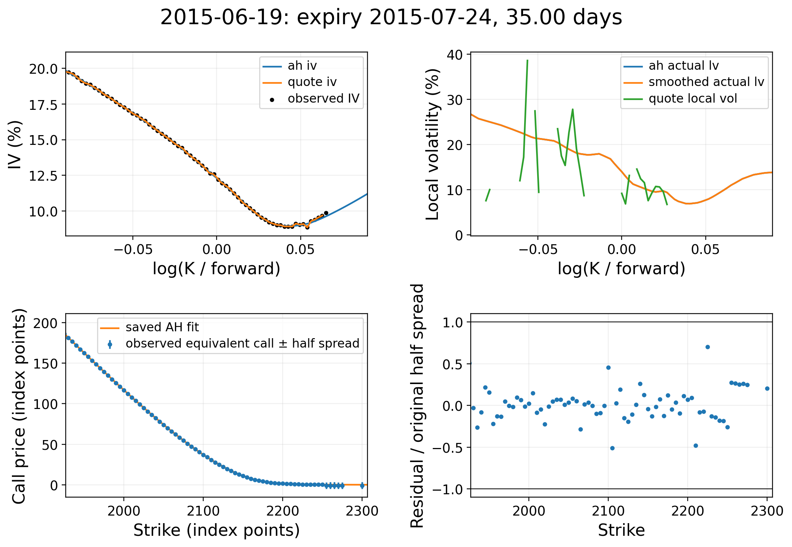
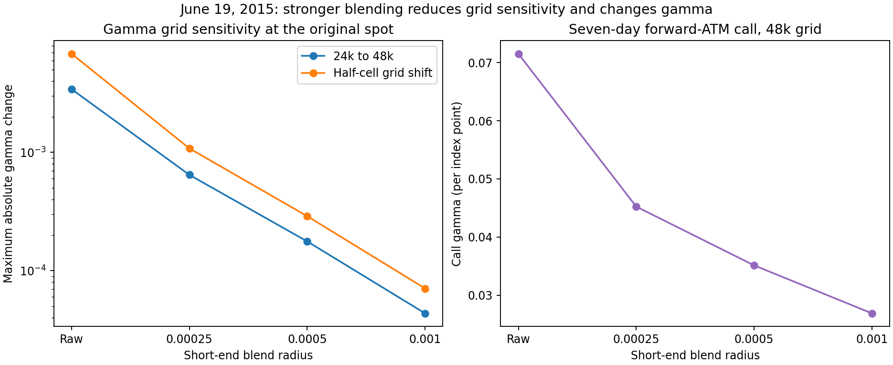
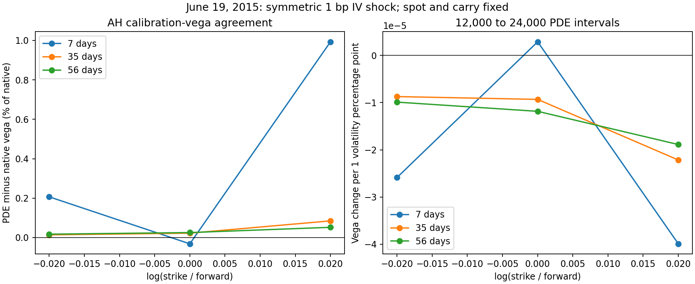
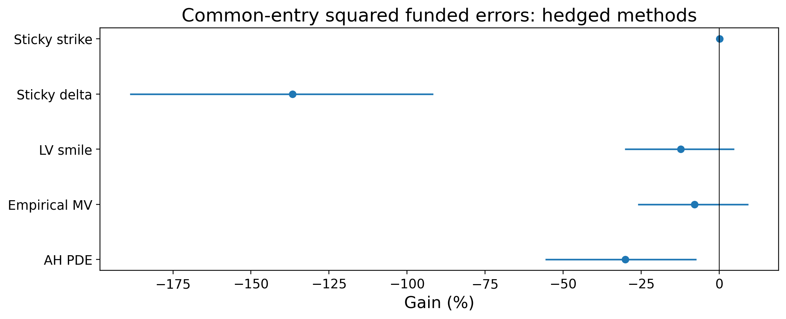
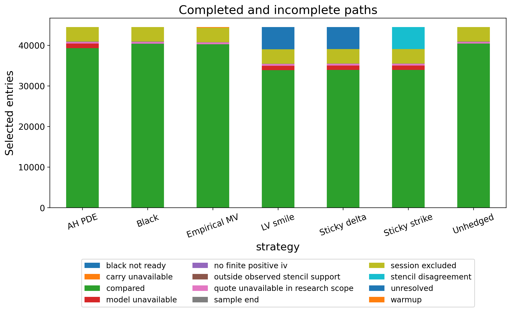

# Abstract

I construct daily SPX volatility surfaces and evaluate chronological, fixed-contract
option hedges from 2013 to 2023. Andreasen–Huge (AH) calibration supplies a
normalized European price surface and a recovered local-variance function. A
backward finite-difference solver calculates prices and spot Greeks. Black,
smile-based and past-only empirical hedges are compared on observed contract
paths under a common self-financing ledger.

The completed retrospective study selected 44,500 entries on 2,768 reference
dates and recorded 3,879,048 completed strategy/schedule/scenario outcomes.
For five-session holdings, daily rebalancing and midpoint execution, AH Gain
was −25.58% on its candidate–Black pairs and −30.16% on the intersection shared
by all methods. The latter represents 30.16% more squared funded error than
Black, with a 95% interval for Gain of [−55.50%, −7.57%] at mean bootstrap block
20 sessions. AH point estimates are negative across all fifteen declared
schedule/execution combinations. A close daily fit to European prices did not
translate into a stable historical hedge advantage under these conventions.

Selected numerical panels support price and delta stability within their
recorded scope; gamma remains sensitive to spatial position and short-end
blending. Thirty dates have unavailable carry before AH optimization. The
31 bad expiry records and 72 scalar ledger replays of selected tail paths
are diagnosed from saved cache without changing the experiment. The results
are research hedge-error comparisons with provisional contract identity,
assumed rates and synthetic execution, rather than executable investment returns.

# Research question and experiment design

The question is whether a surface that matches current option prices produces
better subsequent hedges than Black delta. It separates three tasks: fitting a
cross-section of European prices, solving the resulting pricing model accurately,
and predicting how market prices change over later sessions. Those tasks require
different evidence. Calibration residuals assess fit, analytical controls and
refinements assess numerical behavior, and chronological funded hedge errors
assess the historical comparison.

For each entry, I retain the option's root, expiry, strike and payoff kind.
Rebalancing uses the next current-date model and quote; it does not roll to a
new nearest-at-the-money contract. The declared holding/rebalance schedules
are 1/1, 5/1, 5/5, 10/1 and 10/5 reference sessions. The source data, selection,
model specification and outcomes were frozen before aggregate interpretation.
No historical outcome was revised for the publication.

The entire declared dataset is retrospective. September and October 2023 were
inspected during development, and additional dates were used for numerical
follow-up. Past-only empirical estimation respects information chronology at
each prediction, but does not turn the broader study into an untouched holdout.

# Data, time and financial conventions

The input comprises 132 monthly files with 14,750,241 raw rows. Call and put
sides are separated during preparation. These raw rows are neither the selected
entry count nor independent hedge comparisons. A cash-market reference calendar
contains 2,768 sessions; 24 lack observations. Twenty-one observed early-close
dates are excluded under the provisional clock policy.

Preparation checks the Unix and readable timestamps, stated quote date,
index mark, contract fields, duplicate keys and bid–ask ordering. Invalid or
locked observations remain classified. Entry selection requires positive,
two-sided research quotes. Eligible zero-bid endpoint bounds are handled
separately; missing prices are never replaced by a model price or carried
forward to an adjacent date.

The files do not establish certified SPX/SPXW roots and official settlement
identity for each observation. The research root is `UNKNOWN`, and the assumed
fixing is 16:00 New York PM fixing. Maturity uses elapsed seconds to that fixing
on ACT/365F, including the recorded timezone and daylight-saving transitions.
This is a research convention, not a claim about every contract's official
settlement specification. Paths are closed before expiry; settlement payoffs
are not substituted for observed endpoint marks.

| Convention | Frozen treatment |
| --- | --- |
| Calibration domain | Eligible research quotes within 4–60 calendar days and $|\log(K/S)|\leq0.1$ |
| Entry basket | Nearest 21, 35, 45 day expiries; log spot-moneyness −0.02, 0, +0.02; calls and puts |
| Entry eligibility | 14–45 calendar days, current-date information, deterministic tie breaking |
| Contract key | Root, expiry, strike, payoff kind |
| Pricing discount | Assumed constant 5% rate |
| Pricing forward | Expiry-specific put–call parity fit |
| Cash funding | Constant 5% lending and borrowing |
| Hedge instrument | Fractional synthetic index at observed index mark |
| Hedge-account dividend cash | Zero |
| Execution cases | Midpoint; option bid–ask; option bid–ask plus 1 bp hedge-notional fee |

Pricing yield inferred from the forward curve is distinct from cash dividends
credited to the hedge account. This distinction is preserved in the code and
in interpretation. The synthetic hedge has no verified executable index spread,
futures basis or discrete contract rounding.

# Notation and the local-volatility model

Fix a valuation date as time zero. Let $S_t$ be the index, $K$ the strike, $t$
elapsed model time and $T$ expiry, in years. Prices and strikes use index points.
Let $r(t)$ and $q(t)$ be deterministic pricing rate and yield, with

$$
D(t)=\exp\!\left[-\int_0^t r(u)\,du\right],\qquad
F(t)=S_0\exp\!\left[\int_0^t(r(u)-q(u))\,du\right].
$$

$W^{\mathbb Q}$ denotes risk-neutral Brownian motion; $\Phi$ and $\phi$ are the
standard normal distribution and density. Volatility is annualized in decimal
units; figures use percent. Local variance has units of inverse year.

## Local versus implied volatility

The model dynamics are

$$
\frac{dS_t}{S_t}=(r(t)-q(t))\,dt+
\sigma_{\mathrm{LV}}(S_t,t)\,dW_t^{\mathbb Q}.
$$

The coefficient is a deterministic function of level and time, while the
index path remains stochastic. A constant coefficient recovers the
Black–Scholes special case. Level and maturity dependence allow the calibrated
model to encode a smile and term structure.

Implied volatility instead reproduces one European price under Black's formula:

$$
C(K,T)=D(T)\{F(T)\Phi(d_1)-K\Phi(d_2)\},
$$

$$
d_1=\frac{\log(F(T)/K)+\sigma_{\mathrm{imp}}^2T/2}
{\sigma_{\mathrm{imp}}\sqrt T},\qquad d_2=d_1-\sigma_{\mathrm{imp}}\sqrt T.
$$

Put prices follow parity. The implementation uses stable time-value formulas
and preserves inversion failure statuses at noninvertible midpoints. It does
not manufacture a positive IV to make every quote appear supported. Total
implied variance and log forward-moneyness are

$$
y=\log(K/F(T)),\qquad w(y,T)=\sigma_{\mathrm{imp}}(y,T)^2T.
$$

An implied volatility is a constant-volatility price representation; a local
volatility specifies instantaneous diffusion. They are not interchangeable.

## Forward Dupire equation and density

For a sufficiently regular European call surface, the deterministic-carry
forward equation is

$$
C_T=\tfrac12\sigma_{\mathrm{LV}}^2(K,T)K^2C_{KK}
-(r(T)-q(T))K C_K-q(T)C.
$$

Hence

$$
\sigma_{\mathrm{LV}}^2(K,T)=
\frac{2\{C_T+q(T)C+(r(T)-q(T))K C_K\}}{K^2C_{KK}}.
$$

All derivatives refer to options observed on the same valuation date.
$C_T$ moves along that date's maturity structure at fixed strike; it is not
a difference between prices on two historical quote dates. Under the regular
risk-neutral setting, $C_{KK}=D(T)f_{S_T}(K)$ is discounted terminal density.
Small curvature makes the ratio sensitive to interpolation and price errors.
Admissibility and derivative support therefore precede interpretation of a
local-volatility graph. This is the forward-price construction associated
with Dupire [1].

Strike curvature of a cross-section and backward spot gamma are distinct:
$C_{KK}$ differentiates prices across contracts, whereas $V_{SS}$ differentiates
one fixed contract with respect to its initial state.

## Carry normalization and its derivative convention

Set

$$
z=K/F(T),\qquad c(z,T)=C(F(T)z,T)/(D(T)F(T)).
$$

At fixed physical strike, differentiating this representation gives

$$
C_T=DF\{c_T-(r-q)z c_z-qc\},\quad
C_K=Dc_z,\quad C_{KK}=(D/F)c_{zz}.
$$

Substitution cancels deterministic carry and yields

$$
c_T=\tfrac12 a(z,T)z^2c_{zz},\qquad
 a(z,T)=\frac{2c_T}{z^2c_{zz}},\qquad c(z,0)=(1-z)^+.
$$

Here the normalized derivative $c_T$ holds $z$ fixed, and
$a(z,T)=\sigma_{\mathrm{LV}}^2(F(T)z,T)$. It describes a future state under one
valuation date's surface. Write $a_y(y,T)=a(e^y,T)$ when using log coordinates.

# Daily surface calibration

## Put–call parity and spread weighting

For each date and expiry,

$$
C(K,T)-P(K,T)=D(T)\{F(T)-K\}.
$$

The primary forward fit uses positive two-sided call–put pairs inside
$|\log(K/S)|\leq0.03$ and needs at least six selected pairs. Other parity
windows and rate cases are diagnostics; the frozen primary pricing rate is
5%. A forward can be fitted even when original parity bands are mutually
incompatible; those statuses remain recorded rather than being hidden.

An out-of-the-money side is selected at each strike and converted to an
equivalent call. For a put, adding the deterministic parity offset shifts bid,
ask and midpoint equally, preserving its original half-spread
$h_j=(C_{\mathrm{ask},j}-C_{\mathrm{bid},j})/2$. Noninvertible IV midpoints can
still be price-space calibration observations. Their status remains visible.

## AH implicit construction and objective

AH fits each expiry sequentially. Let $p_i$ denote log-volatility controls and
$\nu_i(z)=\exp[W_i(z)p_i]$ their interpolated proxy volatility. On the finite
normalized-strike grid, the implicit expiry step is

$$
M_i c_i=c_{i-1},\quad M_i=I-\Delta T_i A_i,\quad
 A_i=\tfrac12\nu_i(z)^2z^2\partial_{zz}.
$$

The calibrated objective is

$$
\min_{p_i}\sum_j
\left[\frac{D_iF_i c_i(K_j/F_i;p_i)-C_{\mathrm{mid},j}}{h_j}\right]^2
+\lambda\|L p_i\|_2^2.
$$

$L$ is the first-difference matrix of adjacent log controls, not a second
spatial derivative. The frozen value is $\lambda=1$. Residuals are reported
in original half-spread units and index points, alongside expiry fit counts,
conditioning and original-band exclusions. The objective fits quoted prices;
it does not optimize historical hedge Gain.

The normalized grid is uniform in log strike with 8,000 intervals and
half-width 1.0. Each expiry has at most 31 controls spanning its quoted log
strikes. Proxy volatility is bounded between 0.005 and 3.0; the solver allows
300 evaluations and checks optimizer success. These are bounds on proxy
parameters, not caps on recovered local volatility.

## Proxy parameters and recovered local variance

Inside an expiry interval, the price construction is an implicit resolvent:
$c(\tau)=(I-\tau A_i)^{-1}c_{i-1}$. Differentiation gives

$$
\partial_\tau c=(I-\tau A_i)^{-1}A_i c(\tau).
$$

Consequently the calibrated proxy $\nu_i^2$ need not equal the recovered ratio
$2c_T/(z^2c_{zz})$. The coefficient implementation uses native density and
time derivatives, including logarithmic positive calculations for small wing
quantities. It does not estimate curvature by twice differentiating a
piecewise-linear price interpolant. The implicit construction follows the
AH approach [2], with the specified regularization and diagnostic conventions.

Large recovered coefficients remain visible. Changing a plotting domain is
an explicitly declared display choice; it is not an arbitrage repair or a
cap on the model. Maturity-side derivatives and coefficient jumps are retained
at expiry boundaries.

## Short-end diffusion blend

Before the first fitted maturity $T_1$, the hedge diffusion uses

$$
\widetilde a_y(y,t)=(1-\omega(t))a_y(y,t)
+\omega(t)(G_\rho*a_y)(y,t),\qquad
\omega(t)=(1-t/T_1)^2,\quad 0<t<T_1.
$$

The Gaussian filter acts on variance at native log-state nodes, with radius
$\rho=0.0005$ and finite truncation at four radii. From $T_1$ onward the raw
coefficient is retained. Only positive coefficient times are supported.
This blend changes the diffusion relative to the native calibrated price
surface. Its price and Greek effects require separate checks.

## Quote-PCHIP and constrained SSVI diagnostics

The independent quote construction interpolates total variance with PCHIP
across $y$ and linearly across expiries. Invalid IV observations split
contiguous strike support. It does not bridge gaps or extrapolate a short end
from unsupported quotes. The smooth total-variance Dupire representation is

$$
a_y=\frac{w_T}{g},\qquad
 g=\left(1-\frac{y w_y}{2w}\right)^2
 -\frac{w_y^2}{4}\left(\frac1w+\frac14\right)+\frac{w_{yy}}2.
$$

Availability requires supported derivatives, positive total variance,
nonnegative calendar derivative, a sufficiently positive density denominator,
and stable derivative stencils. Unsupported or unstable local-volatility
points remain gaps. The construction is diagnostic and does not replace the
historical hedge diffusion.

The saved constrained SSVI comparison [3] uses

$$
w(y,\theta)=\frac{\theta}{2}\left[
1+\rho_{\mathrm{SVI}}\varphi(\theta)y+
\sqrt{(\varphi(\theta)y+\rho_{\mathrm{SVI}})^2+1-\rho_{\mathrm{SVI}}^2}\right],
$$

$$
\varphi(\theta)=\frac{\eta}{\sqrt{\theta(1+\theta)}}.
$$

ATM variance starts from zero, is nondecreasing and is interpolated linearly
in time. The constructor requires $|\rho_{\mathrm{SVI}}|<1$, $\eta\geq0$ and
$\eta^2(1+|\rho_{\mathrm{SVI}}|)<4$. These give the implemented sufficient
butterfly restrictions, while the chosen shape and monotone ATM variance
satisfy the calendar condition. Maturity derivatives are one-sided at pillars;
evaluation stops at the final maturity. The restricted shared-shape family
fits the inspected quotes less closely than AH and was not used as a frozen
hedge method. Browsing loads a saved SSVI fit only on its recorded date.




# Backward pricing and spot Greeks

For a normalized state $x$, define
$\widetilde a(x,t)=\widetilde a_y(\log x,t)$.

For a fixed European contract the physical-state backward equation is

$$
V_t+(r(t)-q(t))S V_S+\tfrac12\sigma_{\mathrm{LV}}^2(S,t)S^2V_{SS}-r(t)V=0,
\qquad V(S,T)=(S-K)^+
$$

for a call; a put has $(K-S)^+$ terminal payoff. The hedge solver replaces
$\sigma_{\mathrm{LV}}^2(S,t)$ by the blended coefficient
$\widetilde a(S/F(t),t)$. To remove deterministic carry,
set $X_t=S_t/F(t)$ and $Y_t=\log X_t$. Itô's formula gives

$$
dX_t=X_t\sqrt{\widetilde a(X_t,t)}\,dW_t^{\mathbb Q},\qquad
 dY_t=-\tfrac12\widetilde a_y(Y_t,t)dt+
 \sqrt{\widetilde a_y(Y_t,t)}\,dW_t^{\mathbb Q}.
$$

For normalized conditional payoff $U$, the generator is

$$
U_t+\tfrac12\widetilde a_y(y,t)(U_{yy}-U_y)=0,
\qquad U(y,T)=(e^y-k)^+,\quad k=K/F(T).
$$

With $A(t,T)=D(T)F(T)/D(t)$, the price and Greeks are

$$
V(S,t)=A(t,T)U(\log(S/F(t)),t),\quad
\Delta=\frac{A U_y}{S},\quad
\Gamma=\frac{A(U_{yy}-U_y)}{S^2}.
$$

The code interpolates solved values by a cubic spline in log state and takes
its first and second derivatives. Spot Greeks hold the coefficient function
and deterministic carry fixed. They do not recalibrate after a spot bump.
A chronological rebalance uses a different current-date model, which is a
separate operation.

## Discretization and numerical error controls

The frozen hedge solver has 24,000 log-state intervals, domain half-width 0.75
and 128 nominal steps per day. It uses centered spatial differences and
midpoint coefficient evaluations. Most steps are Crank–Nicolson; the first
two nominal steps backward from the payoff are split into implicit Rannacher
half-steps. The time mesh includes maturity breaks and is graded with power
three toward zero before the first pillar. Actual step counts are recorded.

At the finite state endpoints the normalized terminal-payoff boundary values
are held fixed. The PDE domain stays within the native coefficient domain;
unsupported coefficient extrapolation and zero-time requests fail clearly.
Space, time, domain and state shifts are refined separately. A smaller price
error on one grid does not independently certify gamma convergence.

# Hedge specifications

## Observed-IV Black benchmark

At current spot $S$, forward $F$, discount $D$ and maturity $T$, Black spot delta
and vega are

$$
\Delta_B=\frac{DF}{S}\{\Phi(d_1)-\mathbf 1_{\{\mathrm{put}\}}\},\qquad
\mathcal V_B=DF\phi(d_1)\sqrt T.
$$

The Black spot derivative keeps $F/S$ and IV fixed. Vega is per unit decimal
annual volatility, so multiplying by 0.01 gives sensitivity per volatility
percentage point.

## Smile movement conventions

Let $\sigma_y$ be the slope of fitted implied volatility with respect to
$\log(K/F)$. The hedge rules retain their own availability checks:

| Method | Definition |
| --- | --- |
| AH PDE | Saved backward-PDE spot derivative under the blended local variance |
| Sticky strike | Black delta at fitted IV, with fitted IV held fixed at strike |
| Sticky delta | Fitted-IV Black delta minus fitted-IV vega times $\sigma_y/S$ |
| LV smile | Observed-IV Black delta plus observed-IV vega times $\sigma_y/K$ |
| Empirical MV | Observed-IV Black delta plus a past-data fitted correction |
| Unhedged | Zero index position |

Sticky delta uses an unadjusted normalized forward-call-delta coordinate.
The chain rule and a finite spot bump are compared, and the coordinate must
be invertible. The LV-smile correction uses the fitted smile slope but
observed-IV vega; it is an approximation, not an AH PDE delta. Native-cell
stencil widths and their coarse/fine comparisons remain explicit. Disagreement
or insufficient observed support is an exclusion rather than a fallback hedge.

## Past-only empirical correction

The unconstrained one-period minimum-variance motivation is

$$
h^*=\frac{\operatorname{Cov}(\Delta C,\Delta S)}{\operatorname{Var}(\Delta S)}.
$$

The implemented Hull–White-style feature model [4] uses

$$
x_i=\frac{\mathcal V_{B,i}}{S_i\sqrt{T_i}}
\begin{bmatrix}1&\Delta_{B,i}&\Delta_{B,i}^2\end{bmatrix},\qquad
\Delta_{\mathrm{MV},i}=\Delta_{B,i}+x_i\widehat\beta.
$$

Ordinary least squares fits $\Delta C_i-\Delta_{B,i}\Delta S_i$ against
$x_i\Delta S_i$, with no additional intercept, separately by root and option
kind. The rolling window contains up to 60 past entry dates and requires at
least ten dates and 60 rows, full feature rank and acceptable conditioning.
The condition-number limit is $10^8$. Every admitted outcome endpoint must
be strictly earlier than the prediction timestamp. Incomplete, unavailable
or warm-up fits do not silently substitute another hedge.

This objective uses raw observed price changes. Funding and execution costs
are applied afterward to the multi-session hedge ledger. It is an empirical
specification rather than an exact conditional-variance guarantee for every
holding period or funded account.

# Chronological paths and self-financing accounting

Entry selection uses current-date observations and deduplicates repeated target
buckets that choose the same contract. Future mark or strategy availability
is not used to screen an entry. Holding lengths count reference sessions.
Missing observations, early-close exclusions and strategy failures interrupt
paths with recorded dates and reasons.

For the unit short option, the target index position is the selected delta.
Let $O_i$ be the option position (−1 while held, zero after exit), $H_i$ the index
position, $B_i$ cash and $M_i$ the observed option mark. Over an interval,

$$
B_i^-=B_{i-1}^+\exp(r_f\Delta t_i),\qquad
B_i^+=B_i^--\Delta O_i\,M_i^{\mathrm{fill}}
-\Delta H_i\,S_i^{\mathrm{fill}}-\mathrm{fees}_i.
$$

The account begins with zero initial capital. Entry option proceeds fund the
hedge purchase; any remainder is cash, possibly negative. Funding uses the
opening cash sign, although the declared lending and borrowing rates are both
5%. At exit both the option and index hedge are liquidated. Equity marked to
observed prices is $E_i=B_i+O_i M_i+H_iS_i$.

The midpoint case uses midpoint option fills. The option-spread case sells at
bid and buys back at ask. The final case adds 1 bp of absolute traded hedge
notional, including entry, rebalancing and liquidation. The synthetic index is
filled at the observed mark in every case, without an invented executable
index spread. Dividend cash is zero and is not inferred from parity yield.

Accounting separates option-mark P&L, index P&L, interest and costs. For the
unit conventions,

$$
\Delta E_i=O_{i-1}\Delta M_i+H_{i-1}\Delta S_i+
\mathrm{interest}_i-\mathrm{costs}_i.
$$

The ledger checks both the incremental and cumulative identities. In the
completed study, the largest stored reconciliation is $4.60\times10^{-12}$
index points. This is an accounting residual, not a pricing or hedge-performance
error. Vectorized path outcomes are cross-checked against the scalar ledger
on retained representative paths.

# Statistical comparison and uncertainty

Each candidate is paired with a completed Black outcome on the same entry,
schedule and execution case. The common-entry sample is the intersection
shared by every method, including the unhedged control. A ready path for one
method can fail to enter a pair if its Black counterpart is unavailable.
Coverage retains all selected entries and distinguishes these populations.

For funded P&L $P_i$ around zero,

$$
\mathrm{Gain}=1-\frac{\sum_i P_{i,\mathrm{candidate}}^2}
{\sum_i P_{i,\mathrm{Black}}^2}.
$$

A negative Gain means more squared funded error. It is neither an investment
return nor a reduction of demeaned variance. Squaring around zero includes
mean bias and gives substantial weight to tail outcomes. RMS, mean error,
MAE and paired absolute-error comparisons provide additional diagnostics.
Gain is unavailable when the matched Black SSE is effectively zero.

A stationary date-block bootstrap keeps all contracts from an entry date
together and uses 500 replicates, seed 20261008, and mean block lengths 10,
20 and 40 sessions. Blocks are circular and address dependence from overlapping
holding periods. The percentile interval uses the saved 2.5% and 97.5%
quantiles. Models, entry selection and empirical coefficients are not fitted
again within a replicate, so the intervals are conditional on the retained
historical pipeline. They are not a guarantee for a future execution regime.

Grouping by year, maturity, moneyness and Black-delta bucket uses saved outputs.
An arbitrary entry-date range sums daily candidate SSE, matched Black SSE and
counts before computing descriptive Gain. It never averages daily percentages.
No full-history interval is attached to such a range, and common-entry daily
sufficient statistics were not saved, so common-entry range estimates are
not manufactured.

# Numerical verification

Analytical Black and square-root CEV controls check pricing, Greeks, payoff
parity, transitions and funded accounting. The retained suite is data-free:
it generates small explicitly artificial quote histories and calls the same
core objects. Market evidence remains a separate producer-pinned scope.

On June 19, 2015, 30 contracts, four blend radii, six PDE configurations and
three initial spots give 2,160 sampled states. No sampled evaluation failures,
price/delta-bound flags or negative-gamma flags were recorded. At the original
spot and historical blend radius, the largest 24k-to-48k delta change was
$3.36\times10^{-6}$. Gamma was more sensitive to grid position, blend radius
and bump width. Selected calls on March 16, 2020 and November 9, 2023 reproduced
production deltas within $7.91\times10^{-13}$ on their original grids.

The June calibration-vega panel uses symmetric parallel quote-IV shocks of
1, 2 and 5 basis points, holding carry fixed. It covers 18 contracts and seven
calibrations. Of 597 quotes, 566 support the shock; 31 noninvertible midpoints
remain unchanged and participate in the price fit. The largest native/PDE
relative vega difference is 0.993% for this declared direction. It is not a
validation of every independent calibration pillar.





Seven-date smile replays cover 928 decisions with zero status mismatches.
Fourteen empirical membership checks retain endpoints strictly before the
prediction timestamp. These panels support their stated scopes; they do not
independently validate every Greek in the eleven-year history.

# Full-history findings

The completed study contains 44,500 entries, 2,768 reference dates,
3,879,048 compared strategy/schedule/scenario outcomes and zero pending paths.
Outcomes reuse entries and must not be counted as independent observations.
The five-session, daily-rebalanced midpoint comparison is:

| Method | Paired entries | Pair Gain (%) | Common Gain (%) | Common 95% CI (%) |
| --- | ---: | ---: | ---: | ---: |
| AH PDE | 39,252 | -25.58 | -30.16 | [-55.50, -7.57] |
| Empirical MV | 40,230 | -8.40 | -7.92 | [-25.78, +9.08] |
| LV smile | 33,887 | -12.38 | -12.40 | [-30.03, +4.53] |
| Sticky delta | 33,887 | -136.71 | -136.74 | [-188.49, -91.90] |
| Sticky strike | 33,887 | +0.15 | +0.15 | [-0.04, +0.37] |

The common-entry sample has 33,763 entries across 2,406 entry dates. Its AH
Gain of −30.16% implies a candidate/Black SSE ratio of 1.3016. Empirical MV
and LV smile have intervals spanning zero. Sticky delta has substantially
larger squared errors, and sticky strike's small positive estimate also has
an interval spanning zero. The conclusion is adverse for AH under these
conventions. It does not establish a general hedge-performance improvement.

All fifteen AH schedule/execution point estimates are negative. Some
common-entry intervals include zero; others remain adverse. For midpoint
execution, common-entry AH Gain is −18.42%, −30.16%, −13.71%, −26.10% and
−13.82% for 1/1, 5/1, 5/5, 10/1 and 10/5 respectively. The appendix gives
all five candidate methods, schedules and execution scenarios, with counts
and saved 20-session common-entry intervals. The accompanying compact CSV
also retains pairwise intervals, all three block lengths and the unhedged
control.





A tight fit to today's European prices restricts the current risk-neutral
marginals. It does not establish how tomorrow's observed smile moves, nor
whether the chosen spot hedge minimizes realized multi-session funded errors.
The distinction is consistent with the mixed or adverse historical comparison.
The evidence does not identify a single cause of full-history underperformance.

# Carry exclusions and selected tail diagnostics

Thirty dates have no AH fit because carry is unavailable for at least one
expiry: 20 dates in 2016 and ten in 2022. There are 31 bad expiry records,
including two on May 27, 2022. Each records insufficient selected parity pairs
(three to five), an unavailable conditional fit and unavailable carry. These
are pre-optimization support failures; no expiry is silently removed to make
a daily fit succeed. Available pairs outside the selected parity window do
not satisfy its support requirement.

For six declared dates—March 2, March 3, March 16 and March 26, 2020;
September 19 and November 9, 2023—the diagnostic selects each AH/sticky-delta
contract with the largest signed midpoint excess SSE over matched Black.
Twelve candidate/method paths are replayed against Black in all three cases:
36 paired scenario checks, or 72 scalar ledgers. The maximum discrepancy in
P&L, costs, funding, turnover and component P&L is $1.49\times10^{-12}$
index points. This is an outcome-selected diagnostic, not new performance data.

The selected contract remains the midpoint-selected contract in each scenario.
Daily candidate SSE, Black SSE and pair counts on a scenario row are computed
from that row's execution case. Thus spread/fee rows do not repeat midpoint
statistics under an unlabeled generic heading. For March 16, 2020 AH, the
18 midpoint pairs have candidate/Black daily SSE 153,541.47/93,737.10;
option-spread pairs have 135,005.20/79,435.75; and spread-plus-fee pairs have
134,048.80/78,731.80. The counts coincide here, while funded SSE differs.

For a selected pair, candidate minus Black P&L separates into first-interval
and later-interval hedge contributions, funding difference and cost difference.
Observed option-mark P&L is the same within the pair and cancels. Replayed
later contributions use actual saved rebalances. Their signs and magnitudes
vary by date; entry-date Greek refinements alone do not explain entire paths.
Full contract identities, exclusions, intervals and scenario statistics remain
in the curated and producer-pinned diagnostic tables.

# Interpretation and limitations

The project delivers a daily calibrated surface, recovered local variance,
backward pricing and Greek objects, transparent hedge conventions and a
chronological historical comparison. The principal finding is that AH did
not provide a stable hedge advantage over Black under the declared assumptions.
The result is retained even though the daily price fit is close.

The available data do not certify roots, snapshot provenance or official
fixings. Pricing and funding rates are assumed constants. Synthetic fractional
index execution, zero hedge-account dividend cash and provisional settlement
identity limit interpretation of the funded ledger. Exclusions alter available
samples, and common-entry matching cannot remove all such selection effects.

The history is retrospective; the bootstrap is conditional on frozen estimates
and does not re-estimate the model. Selected numerical refinements do not
certify every historical delta or gamma. Broader gamma validation, all-history
Greek verification, more flexible SSVI calibration and deployable hedge
execution are outside the completed evidence. No model tuning was performed
to recover an unsupported performance target.

# Reproducibility and artifact identity

The frozen fingerprint is:

```text
09c095fb8a89f2ab811b2bddb393ce0a9258a8d013095b8c23a9960dd6b4a232
```

The SHA-256 of `freeze.json` is:

```text
b54c0bb421abb14fa64e1e223d796982312bbc34a7c02bb182829538a6207c7e
```

These identify the completed original study. Its recorded environment is
Python 3.11.15, NumPy 2.4.3, pandas 2.3.3 and SciPy 1.17.1. Producer audits
pin consumed model, quote, carry, decision and summary files.

The public source is available at
[github.com/KVInator/local-vol-spx](https://github.com/KVInator/local-vol-spx).
Private raw data and the multi-year cache are not distributed. The public
repository includes editable report source, this PDF, curated figures, summary
CSV files and their provenance. The data-free unit suite and report rendering
can run without the private study. Recreating empirical figures or browsing
daily cached surfaces requires the recorded study and configured paths.

Use `PYTHONPATH=src python -m unittest discover -s tests` from the root.
The notebooks share `config/notebooks.json`. An unavailable requested date
remains unavailable through display-control changes; explicitly choosing a
saved date restores synchronized content. Missing optional numerical/SSVI
folders are reported without blocking the required historical study. Present
malformed audits, mismatched study identities and changed producer outputs
remain errors.

The PDF is rendered from this authoritative Markdown by the single documented
Pandoc/Tectonic path. Temporary TeX files, logs, caches and inspection images
are confined to `scratch/`. Figure provenance records the selected date,
domain, maturity, units, schedule, sample and input/output hashes.

# References

1. Bruno Dupire (1994), *Pricing with a Smile*, Risk 7(1), 18–20.
   [Publisher reprint](https://www.risk.net/sites/default/files/import_unmanaged/risk.net/data/Pay_per_view/risk/technical/1994/risk_0194_volatility.pdf).
2. Jesper Andreasen and Brian Huge (2011), *Volatility Interpolation*, Risk.
   [Publisher page](https://www.risk.net/derivatives/2029822/volatility-interpolation).
3. Jim Gatheral and Antoine Jacquier (2014), *Arbitrage-free SVI volatility surfaces*,
   Quantitative Finance 14(1), 59–71; author manuscript arXiv:1204.0646.
   [Author manuscript](https://arxiv.org/abs/1204.0646).
4. John Hull and Alan White (2017), *Optimal Delta Hedging for Options*,
   Journal of Banking and Finance 82, 180–190; first working version September 2015.
   [Author manuscript](https://www-2.rotman.utoronto.ca/~hull/downloadablepublications/Optimal%20Delta%20Hedging.pdf).

# Appendix: saved schedule and execution comparisons

Schedules are holding/rebalance reference sessions. Gain and interval bounds
are percentages. Pair N is the candidate–Black paired entry count. Common
Gain and its 95% interval use the intersection shared by all methods for the
same schedule and execution case, with 500 replicates and mean block 20
sessions. These are saved estimates, not a new bootstrap run.

## Midpoint execution

| Schedule | Method | Pair N | Pair Gain (%) | Common Gain (%) | Common 95% CI (%) |
| --- | --- | ---: | ---: | ---: | ---: |
| 1/1 | AH PDE | 43,185 | -18.66 | -18.42 | [-44.35, +2.43] |
| 1/1 | Empirical MV | 43,527 | +4.64 | +4.93 | [-8.89, +16.71] |
| 1/1 | LV smile | 41,903 | -6.93 | -6.93 | [-31.00, +11.99] |
| 1/1 | Sticky delta | 41,903 | -136.35 | -136.37 | [-166.89, -109.78] |
| 1/1 | Sticky strike | 41,903 | +0.05 | +0.05 | [-0.01, +0.12] |
| 5/1 | AH PDE | 39,252 | -25.58 | -30.16 | [-55.50, -7.57] |
| 5/1 | Empirical MV | 40,230 | -8.40 | -7.92 | [-25.78, +9.08] |
| 5/1 | LV smile | 33,887 | -12.38 | -12.40 | [-30.03, +4.53] |
| 5/1 | Sticky delta | 33,887 | -136.71 | -136.74 | [-188.49, -91.90] |
| 5/1 | Sticky strike | 33,887 | +0.15 | +0.15 | [-0.04, +0.37] |
| 5/5 | AH PDE | 39,957 | -12.99 | -13.71 | [-33.09, +4.33] |
| 5/5 | Empirical MV | 40,299 | +0.17 | +0.28 | [-9.68, +9.55] |
| 5/5 | LV smile | 38,775 | -5.87 | -5.88 | [-22.11, +9.96] |
| 5/5 | Sticky delta | 38,775 | -73.11 | -73.11 | [-89.24, -56.60] |
| 5/5 | Sticky strike | 38,775 | +0.02 | +0.02 | [-0.01, +0.04] |
| 10/1 | AH PDE | 33,434 | -23.53 | -26.10 | [-56.12, -0.01] |
| 10/1 | Empirical MV | 34,939 | -11.28 | -10.96 | [-39.21, +10.23] |
| 10/1 | LV smile | 24,980 | -2.23 | -2.25 | [-24.08, +17.28] |
| 10/1 | Sticky delta | 24,980 | -157.74 | -157.79 | [-194.61, -126.91] |
| 10/1 | Sticky strike | 24,980 | +0.04 | +0.04 | [-0.39, +0.43] |
| 10/5 | AH PDE | 34,662 | -12.59 | -13.82 | [-31.64, +3.94] |
| 10/5 | Empirical MV | 35,362 | -3.17 | -3.34 | [-11.58, +5.96] |
| 10/5 | LV smile | 32,483 | -4.74 | -4.74 | [-18.09, +9.14] |
| 10/5 | Sticky delta | 32,483 | -69.97 | -69.97 | [-85.20, -57.71] |
| 10/5 | Sticky strike | 32,483 | -0.08 | -0.08 | [-0.18, +0.02] |


## Option bid–ask execution

| Schedule | Method | Pair N | Pair Gain (%) | Common Gain (%) | Common 95% CI (%) |
| --- | --- | ---: | ---: | ---: | ---: |
| 1/1 | AH PDE | 43,185 | -12.87 | -12.52 | [-34.72, +4.99] |
| 1/1 | Empirical MV | 43,527 | +3.98 | +4.19 | [-8.18, +14.02] |
| 1/1 | LV smile | 41,903 | -3.79 | -3.79 | [-24.40, +12.02] |
| 1/1 | Sticky delta | 41,903 | -108.34 | -108.35 | [-128.33, -87.50] |
| 1/1 | Sticky strike | 41,903 | +0.04 | +0.04 | [+0.01, +0.07] |
| 5/1 | AH PDE | 39,252 | -23.52 | -28.44 | [-56.23, -5.22] |
| 5/1 | Empirical MV | 40,230 | -8.60 | -8.26 | [-26.76, +8.41] |
| 5/1 | LV smile | 33,887 | -12.50 | -12.51 | [-31.42, +5.04] |
| 5/1 | Sticky delta | 33,887 | -125.99 | -126.00 | [-171.95, -84.65] |
| 5/1 | Sticky strike | 33,887 | +0.14 | +0.14 | [-0.06, +0.38] |
| 5/5 | AH PDE | 39,957 | -13.00 | -13.74 | [-34.23, +5.17] |
| 5/5 | Empirical MV | 40,299 | -0.56 | -0.48 | [-11.16, +8.96] |
| 5/5 | LV smile | 38,775 | -6.22 | -6.22 | [-23.74, +10.24] |
| 5/5 | Sticky delta | 38,775 | -70.36 | -70.37 | [-86.09, -54.59] |
| 5/5 | Sticky strike | 38,775 | +0.03 | +0.03 | [-0.00, +0.06] |
| 10/1 | AH PDE | 33,434 | -26.34 | -30.45 | [-65.56, -2.16] |
| 10/1 | Empirical MV | 34,939 | -13.85 | -14.46 | [-42.92, +6.86] |
| 10/1 | LV smile | 24,980 | -6.56 | -6.58 | [-31.88, +14.47] |
| 10/1 | Sticky delta | 24,980 | -149.08 | -149.11 | [-185.23, -118.06] |
| 10/1 | Sticky strike | 24,980 | -0.00 | -0.00 | [-0.46, +0.40] |
| 10/5 | AH PDE | 34,662 | -13.95 | -15.31 | [-33.87, +3.92] |
| 10/5 | Empirical MV | 35,362 | -4.57 | -4.84 | [-13.65, +5.05] |
| 10/5 | LV smile | 32,483 | -6.21 | -6.21 | [-20.85, +8.74] |
| 10/5 | Sticky delta | 32,483 | -67.69 | -67.69 | [-83.67, -55.22] |
| 10/5 | Sticky strike | 32,483 | -0.07 | -0.07 | [-0.17, +0.04] |


## Option bid–ask plus hedge fee

| Schedule | Method | Pair N | Pair Gain (%) | Common Gain (%) | Common 95% CI (%) |
| --- | --- | ---: | ---: | ---: | ---: |
| 1/1 | AH PDE | 43,185 | -12.30 | -11.95 | [-33.19, +4.92] |
| 1/1 | Empirical MV | 43,527 | +3.75 | +3.95 | [-7.89, +13.54] |
| 1/1 | LV smile | 41,903 | -3.66 | -3.66 | [-23.43, +11.44] |
| 1/1 | Sticky delta | 41,903 | -103.41 | -103.43 | [-122.03, -83.27] |
| 1/1 | Sticky strike | 41,903 | +0.03 | +0.03 | [+0.00, +0.06] |
| 5/1 | AH PDE | 39,252 | -23.27 | -28.24 | [-56.24, -5.03] |
| 5/1 | Empirical MV | 40,230 | -8.78 | -8.46 | [-27.24, +8.14] |
| 5/1 | LV smile | 33,887 | -12.72 | -12.73 | [-31.74, +4.59] |
| 5/1 | Sticky delta | 33,887 | -123.42 | -123.43 | [-167.94, -83.03] |
| 5/1 | Sticky strike | 33,887 | +0.14 | +0.14 | [-0.07, +0.37] |
| 5/5 | AH PDE | 39,957 | -13.13 | -13.86 | [-34.35, +5.35] |
| 5/5 | Empirical MV | 40,299 | -0.70 | -0.62 | [-11.39, +8.84] |
| 5/5 | LV smile | 38,775 | -6.38 | -6.38 | [-24.14, +10.22] |
| 5/5 | Sticky delta | 38,775 | -69.90 | -69.91 | [-85.67, -54.11] |
| 5/5 | Sticky strike | 38,775 | +0.03 | +0.03 | [-0.01, +0.06] |
| 10/1 | AH PDE | 33,434 | -26.73 | -31.18 | [-67.75, -2.69] |
| 10/1 | Empirical MV | 34,939 | -14.37 | -15.09 | [-43.63, +6.09] |
| 10/1 | LV smile | 24,980 | -7.59 | -7.60 | [-33.98, +13.83] |
| 10/1 | Sticky delta | 24,980 | -146.59 | -146.62 | [-182.40, -115.97] |
| 10/1 | Sticky strike | 24,980 | -0.02 | -0.02 | [-0.48, +0.38] |
| 10/5 | AH PDE | 34,662 | -14.19 | -15.57 | [-34.47, +3.90] |
| 10/5 | Empirical MV | 35,362 | -4.81 | -5.09 | [-14.08, +4.86] |
| 10/5 | LV smile | 32,483 | -6.50 | -6.50 | [-21.27, +8.59] |
| 10/5 | Sticky delta | 32,483 | -67.29 | -67.30 | [-83.37, -54.57] |
| 10/5 | Sticky strike | 32,483 | -0.07 | -0.07 | [-0.17, +0.03] |
