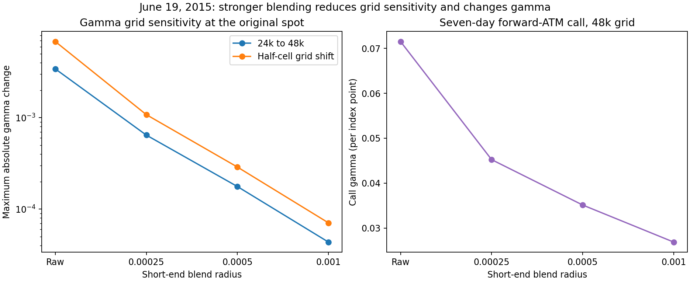
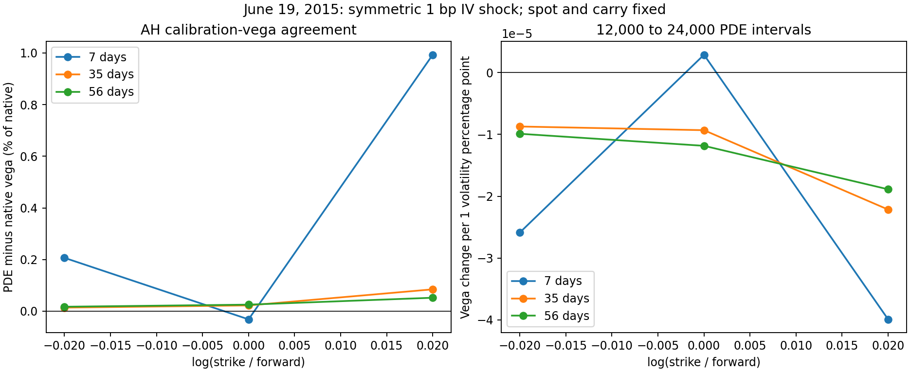

# Numerical validation

Analytical Black and CEV controls test prices, payoff parity, Greeks and ledger
accounting. AH tests cover calibration invariants, price-shape checks, carry
consistency and the recovered coefficient. Quote interpolation retains
unsupported regions, negative calendar/density diagnostics and unstable
derivatives as gaps.

## Retained market checks

The June 19, 2015 panel covers 30 contracts, four blend radii, six PDE settings
and three initial spots: 2,160 states. No evaluation failures or sampled
price/delta-bound or negative-gamma flags were recorded. At the original spot
and historical blend radius, the largest 24k-to-48k delta change is
3.36e-06. Gamma is more sensitive to grid position, blend radius and
spot-bump width.



The same-date calibration-vega panel covers 18 contracts and seven calibrations.
Symmetric 1, 2 and 5 volatility-basis-point shocks affect 566 of 597
quotes. The 31 noninvertible midpoints remain unchanged and participate
in calibration. The largest native/PDE relative vega difference is
0.993% for this parallel quote-IV shock direction, with carry
held fixed. This is a directional sensitivity, not a validation of every
individual calibration pillar.



Selected calls at March 16, 2020 and November 9, 2023 were repriced on production,
finer and shifted grids. Production deltas reproduce saved values within
7.91e-13. These are entry-date numerical checks. The independent
scalar-ledger replay in [cache diagnostics](cache_checks.md) checks subsequent
decisions, observed marks, funding and costs without new PDE evaluation.

Seven-date smile replays cover 928 decisions, with zero recorded status mismatches. Empirical-fit membership
checks verify that training endpoints precede prediction timestamps. Their
producer audits and output hashes remain attached to
`scratch/runs/market_validation`; the explorer loads only date-matched rows.
The June saved constrained SSVI comparison is retained as a separate quote-fit
diagnostic, with its original producer pins.

## Automated verification

The data-free suite uses analytical references and synthetic quotes. It covers:

- Black and CEV prices and Greeks; AH calibration and recovered variance;
  backward-PDE convergence and short-end blending.
- Scalar and vectorized funded ledgers, fixed-contract paths, transaction costs
  and independent SSE/count aggregation.
- Strictly past-only empirical training, failure statuses and bootstrap inference.
- Saved-input identity, checksums, relocation, compressed exports and cache reuse.
- Synchronized notebook controls, failed date selections, missing optional
  evidence and serial/parallel numerical workflows.

Run it from the repository root:

```bash
PYTHONDONTWRITEBYTECODE=1 PYTHONPATH=src MPLBACKEND=Agg \
  MPLCONFIGDIR="$PWD/scratch/cache/matplotlib" \
  python -m unittest discover -s tests
```

[CI](../.github/workflows/verification.yml) runs the same suite on Python 3.11.
Synthetic fixtures exercise the analysis interfaces without private data.
Saved-study verification additionally requires the retained market cache.

## Saved-study verification and limits

Both notebooks were executed against the completed study in `volspx`, including
rendered figures, date changes, carry failures and historical range controls.
The latest retained evidence is in
`scratch/runs/storage_cleanup_2026-11-02/notebooks`; those checks disabled study
producers. The [storage record](storage_cleanup.md) also documents export
compression, checksum verification and the historical checkpoint retention exception.

The retained panels cover selected dates, contracts and shock directions.
Broader gamma validation, every historical Greek, more flexible SSVI fitting
and deployable hedge execution remain outside the evidence.
[Assumptions](assumptions.md) records the financial and retrospective scope;
[reproducibility](reproducibility.md) lists commands and required inputs.
